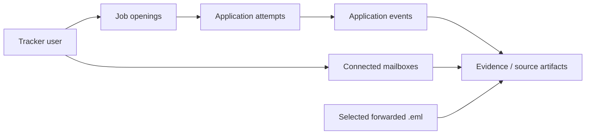

# Ledger

**An effortless, evidence-backed job application tracker.**

Ledger is a planned privacy-conscious application tracker that reconstructs and maintains application histories from dedicated Gmail accounts and selectively forwarded emails. It is designed for people who apply to many roles, sometimes more than once with different contact details, and do not want to maintain a spreadsheet or manually update statuses.

> **Project status:** Initial executable TypeScript domain foundation with automated tests; Gmail/API/dashboard are not implemented yet.

## What Ledger should do

- Connect multiple **dedicated job-search Gmail accounts** for ongoing read-only synchronization.
- Discover recent application confirmations, assessments, interview invitations, rejections, and offers.
- Group submissions under the correct **job opening**, while retaining **independent application attempts** and their applicant email/phone snapshots.
- Import older job-related correspondence from a personal mailbox by **selective forwarding as .eml attachments**—without connecting the personal mailbox.
- Start with a **rolling 60-day historical import** per connected mailbox; keep monitoring known applications beyond 60 days.
- Show explicit **coverage**: continuously monitored, forwarded/manual, incomplete backfill, or disconnected.
- Preserve evidence, surface ambiguity, and make incorrect matches reversible. Silence is not a rejection.
- Minimize access to sensitive mail: inspect candidate headers before fetching message bodies; avoid storing full bodies.

## Domain model at a glance



A **job opening** can have multiple **submission attempts**, even if contact details overlap. A different address or phone number does **not** prove an employer's ATS treats the submission as a different candidate.

## Privacy model

The recommended setup is to connect rarely used, dedicated job-search accounts and **not connect your primary personal inbox**. Existing applications can be imported selectively. A dedicated account is still sensitive: it may contain OTPs, login/reset links, and private recruiting conversations. Gmail read-only OAuth still authorizes broad mailbox access; filtering is an application behavior, **not an OAuth permission boundary**.

Ledger is intended to be an application-event extractor, **not a general-purpose inbox reader**. Read [privacy and security](docs/privacy-security.md) before implementing email access.

## Architecture (proposed)

- **Web:** Next.js + TypeScript
- **Backend:** TypeScript modular monolith (NestJS or Fastify; decision pending)
- **Persistence:** PostgreSQL with transactional, evidence-linked application history
- **Async processing:** A durable, PostgreSQL-backed job queue initially
- **Ingestion:** Gmail read-only + user-selected forwarded .eml messages
- **Inference:** Rules/template extraction first; optional, privacy-reviewed model fallback later
- **Operational model:** Scheduled incremental Gmail sync for V1, with Gmail push as an optional future optimization

These are design choices, **not dependencies already installed**.

## Read the specifications

| Document | Purpose |
| --- | --- |
| [System architecture](docs/architecture.md) | Components, boundaries, data flow, reliability |
| [Data model](docs/data-model.md) | Job/attempt identity, evidence, lifecycle, constraints |
| [Email ingestion](docs/ingestion.md) | OAuth, 60-day backfill, Gmail synchronization, selective forwarding |
| [Privacy & security](docs/privacy-security.md) | Threat model, access minimization, security controls, launch gates |
| [MVP scope](docs/mvp.md) | User stories, non-goals, acceptance criteria |
| [Roadmap](docs/roadmap.md) | Implementation sequence and milestones |
| [Test strategy](docs/testing.md) | Ground-truth datasets, edge cases, security and recovery tests |
| [Decisions and open questions](docs/decisions.md) | Draft design decisions requiring validation |

## Product rules

1. **An email inbox is not an applicant identity.** The email and phone entered in a submission are attempt attributes, often unknown.
2. **An opening is not an attempt.** Rejection of one attempt never rejects every attempt.
3. **An update is not truth without evidence.** Classifiers propose events; validation resolves them.
4. **60 days is not a TTL.** The initial backfill and default dashboard window do not limit ongoing monitoring or erase history.
5. **Unobserved is not unanswered.** Disconnected/forward-only accounts have incomplete monitoring coverage.
6. **Application submissions should not be automatically repeated.** Ledger tracks attempts and does not circumvent employer screening or duplicate-detection policies.

## Run the first executable slice

Requires **Node.js >= 22.16**. The domain modules rely only on built-in Node support for TypeScript type stripping; no services or credentials are needed.

```bash
npm install
npm test
npm run typecheck
npm run demo
```

The current code includes deterministic, privacy-conscious **job and application-attempt resolution**, a minimal header-only candidate/secret gate, and **pure event-state projection** with conflict detection. `npm run demo` uses synthetic employer/identity data. **No Gmail account is accessed, no database is connected, and no production API or dashboard exists yet.** The planned PostgreSQL schema lives at [migrations/0001_core.sql](migrations/0001_core.sql). The schema is a starting migration, not proof of deployed storage.

## First engineering milestone

Deliver a headless, testable pipeline that ingests synthetic Gmail-like fixtures, extracts candidate application events, and accurately resolves **multiple attempts for one opening** without any access to real mail. Next, add an explicitly authorized Gmail test account and instrument minimal data access.

See [roadmap](docs/roadmap.md) for the staged plan.

## References

Google Gmail API documentation: [scopes](https://developers.google.com/workspace/gmail/api/auth/scopes), [list messages](https://developers.google.com/workspace/gmail/api/reference/rest/v1/users.messages/list), [get messages](https://developers.google.com/workspace/gmail/api/reference/rest/v1/users.messages/get), [sync](https://developers.google.com/workspace/gmail/api/guides/sync), [push notifications](https://developers.google.com/workspace/gmail/api/guides/push). Compliance: [restricted-scope verification](https://developers.google.com/identity/protocols/oauth2/production-readiness/restricted-scope-verification).
