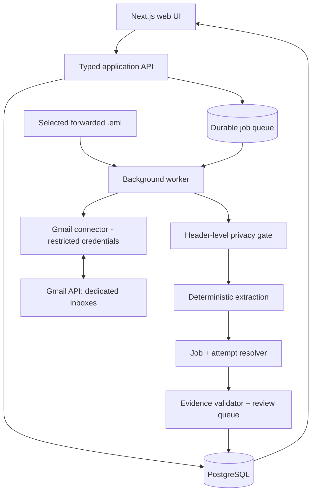
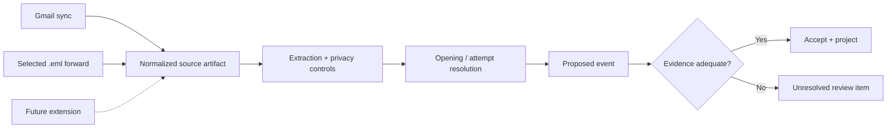

# System architecture

**Status:** Proposed, 2026-10-13. The repository currently contains specifications only.

## 1. Design goals and invariants

Ledger turns authorized recruitment correspondence into an **evidence-backed timeline of application attempts**. It is not a universal Gmail client, application auto-submitter, or employer ATS integration.

Core invariants:

1. One user connects zero or more **mailboxes**, and one mailbox has its own credentials, backfill progress, error state, and sync cursor.
2. A **job opening** is a vacancy/requisition, not an application. One opening has many **application attempts**.
3. Attempts snapshot submitted contact details (**email and phone, both nullable**) and remain separate even when those values repeat. The employer may recognize them as one candidate; Ledger cannot infer that.
4. Every inferred lifecycle change must have provenance and a review/acceptance state. **No response** is a derived inactivity indicator, never a rejection.
5. The application life cycle and the opening's availability are independent.
6. A 60-day default **backfill** does not cap later synchronization, dashboard attention, or retention.
7. An imported primary-inbox application can be **not continuously monitored**; the UI must say so.
8. At-least-once delivery and retries must not duplicate attempts or application events.

## 2. Component view



**Security boundary:** only the Gmail connector can decrypt/use Gmail credentials. The rest of the application works on minimal typed source artifacts and extracted signals. The application API never needs raw email bodies. Enforce this boundary by code/package interfaces **and** runtime permissions, not only coding convention.

## 3. Modules and responsibilities

| Module | Owns | Explicitly does not own |
| --- | --- | --- |
| User/auth | Ledger user, sessions, authorization | Gmail mailbox read authorization |
| Mailbox connections | Gmail OAuth connection, refresh-token encryption, disconnect/revoke | Interpretation of email contents |
| Ingestion | Backfill, history cursor, per-account jobs, source identity | Application outcome decisions |
| Privacy gate | Candidate discovery, header-first filtering, secret suppression | Full mailbox storage |
| Extraction | Candidate message classification, typed job/applicant/event signal | Database mutation |
| Resolution | Company, opening, specific attempt matches; conflict/review | Assuming duplicate identity from phone/email |
| Application domain | Accepted events, status projection, manual corrections | Gmail access |
| UI/read model | Timeline, evidence explanation, coverage, user reviews | Treating inactivity as rejection |
| Observability | Safe operational metrics/audit trail | Storing raw message bodies or secrets in logs |

A PostgreSQL-backed durable queue is an initial proposal (e.g. pg-boss); persistence and worker execution should be separate processes. No Kafka, Kubernetes, or separate AI service in V1.

## 4. Ingestion paths converge on one contract



A normalized source artifact includes the **origin type**, mailbox/source provenance, transport timestamps, original sender/recipient when trustworthy, and a stable source fingerprint. Treat forwarded envelope metadata differently from attached original-message metadata; never infer the applicant email from the forwarding recipient.

## 5. End-to-end example

The same opening receives a submission through account A and a later submission through account B. An interview invitation later arrives at account B.

1. The sync worker discovers the candidate message and retrieves headers.
2. The privacy gate permits targeted body access, parses it transiently, and outputs a structured **INTERVIEW_INVITED** signal.
3. Job resolver matches a requisition ID or canonical URL to the opening.
4. Attempt resolver examines applicant email, ATS application ID, dates, and existing evidence to select **attempt B**. Account B alone is not a sufficient matching rule.
5. Validator checks chronology, source trust, conflicting attempts and duplications.
6. An accepted event is appended and the attempt's read model is projected. Attempt A remains unchanged.
7. If evidence is insufficient, the signal remains unresolved; there is **no status mutation**.

A reopened listing and an older submission should not be automatically merged as a new attempt without submission evidence.

## 6. Transaction and failure boundaries

- Make sync jobs **at-least-once** and idempotent, using unique source keys plus deterministic event dedupe keys.
- Persist discovered Gmail message IDs / durable processing tasks before advancing that mailbox's history cursor. Cursor updates and durable work registration must be atomic from Ledger's perspective.
- Do not require event extraction to finish before cursor advance if each work item is safely durable and retryable.
- Use per-mailbox leases or advisory locks to prevent competing cursor commits; do not block other accounts on failure.
- Quarantine malformed/untrusted sources with sanitized errors; retry rate-limited or transient Gmail failures with bounded exponential backoff.
- Re-run extractors by **version** without manufacturing duplicate attempts; accepted events keep immutable provenance and manual corrections take precedence.
- Event and state projection writes must occur in one database transaction. Projections can be deterministically rebuilt from accepted history.

## 7. Status and coverage are distinct

- Recruitment **stage**: APPLIED, ASSESSMENT, INTERVIEW (and possibly unknown).
- Recruitment **outcome**: PENDING, REJECTED, OFFERED, WITHDRAWN. A terminal outcome requires explicit evidence or user confirmation.
- Job **listing state**: UNKNOWN, OBSERVED_OPEN, OBSERVED_CLOSED, with last-checked time. An online listing does not prove an application remains under review.
- Monitoring **coverage**: CONTINUOUS_HEALTHY, CONTINUOUS_DEGRADED, FORWARD_OR_MANUAL, DISCONNECTED, BACKFILL_INCOMPLETE. Derive this from sources and sync health, not from application status.
- **Inactivity**: derived duration since latest evidenced action; does not mutate stage/outcome.

## 8. Suggested logical project structure

```text
apps/
  web/                # Next.js UI (planned)
  api/                # HTTP endpoints and OAuth callbacks (planned)
  worker/             # Gmail sync and extraction jobs (planned)
packages/
  domain/             # Attempts, events, validation, projections
  ingestion/          # Source contracts, Gmail and .eml adapters
  intelligence/       # Rules, parsers, matching decisions
  db/                 # Schema, migrations, transactions
  shared/             # Cross-boundary types
docs/
```

The structure is guidance, **not scaffolded application code**.

## 9. Operational signals

Per mailbox: last success, last attempt, history cursor age, scan completeness, rate limits, errors, queued work and recovered 404 cursors. Per classifier: bodies fetched vs headers read, candidate hit rate, manual-review rate, false merges, observed extraction precision/recall. Never log message content, OTPs, OAuth credentials or signed URLs.

## 10. Key open decisions

- Framework and deployment target (NestJS vs Fastify, managed Postgres/provider).
- Whether model-assisted extraction is needed after rule-based benchmarks.
- Exact retention/deletion policy and operational encryption key management.
- Gmail production compliance and restricted-scope review before external launch.

See [data model](data-model.md), [ingestion](ingestion.md), [privacy](privacy-security.md) and [decisions](decisions.md).
