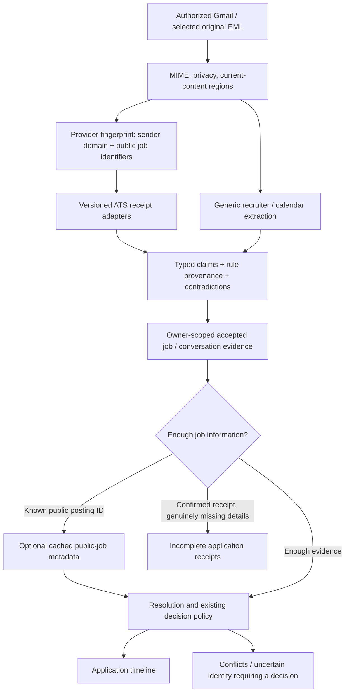

# Reducing manual application review

## Finding

The main reported failure is **missing company or role**, rather than conflicting outcomes.
Those need different remedies. A confirmation may prove an application was received while
omitting its job title. It should not require the same decision as a contradictory rejection,
and employer-only receipts must not be merged into an arbitrary job.

The current system already has MIME parsing, privacy checks, current/quoted region separation,
weighted field candidates, versioned signals, owner-scoped conversation matching, sole-attempt
matching, reconciliation, and review grouping. Replacing those with another large expression
does not address the missing layer: ATS-aware receipts and job identity.

Before this change, all 92 synthetic development emails and 15 fixed holdout emails scored
correctly, but five new explicit-title layouts reproduced missing titles. This is evidence of
limited test coverage, not evidence of high accuracy on the user's mailbox. The eight new ATS
examples are constructed development fixtures, not independent vendor samples or holdout data.

## Recommended flow

### 1. Provider adapters, with a generic fallback

Select an adapter using exact domain boundaries or a recognized public job key. A platform name
in the display name is insufficient. Provider recognition is parsing context; authentication and
event authority remain separate policy decisions.

Each adapter should return typed candidate claims with stable rule IDs, its recipe version,
public job identity when present, missing fields, and contradiction/inspection-limit flags.
It must not mutate the database, grant sender trust, infer an applicant from the recipient,
invent an employer from a tenant slug, or fetch links while parsing. Employer-customized mail
can fall back to the generic extractor. Several platforms can share a narrowly defined recipe.

The first implemented recipe reads explicit receipt fields such as `Position applied for`,
split `Job Title` rows, and a job title linked to the exact recognized public posting. It is
selected for Greenhouse, Lever, Workday, Ashby, SmartRecruiters, iCIMS, and Workable. This is
support for that recipe on those platforms, not a claim to understand all their email templates.
Candidates use the existing validators and conflict veto. Repeated assertions retain one
support source. Bare job links, suggested jobs, private portal links, signatures and quoted
history do not provide application titles. Limits fail toward review.

HTML structure is useful for preserving field rows and anchor boundaries. A browser-compatible
HTML parser such as parse5 is a possible later replacement for the hand-written scanner, after
differential MIME/quote/privacy tests. It supplies structure, not the meaning of an application;
an AST alone cannot recover a title absent from the message.

### 2. Public posting metadata as bounded enrichment

When an email contains an exact `(provider, tenant, requisitionId)` but not a title, first consult
owner-scoped accepted job evidence. A reviewed provider integration may then request public
posting metadata using only the job identifiers. Greenhouse's Job Board interface and Lever's
Postings API expose this surface separately from employer application-management APIs.

Keep enrichment outside the MIME parser and outside the Gmail cursor transaction. Use durable
work with a strict request budget, timeouts, small response limits, exact fixed API hosts,
no redirects, no arbitrary email URLs, and a cache keyed by provider/region/tenant/posting ID.
Do not transmit message text, recipient details, private access tokens, or Google credentials.
Never request employer-only ATS credentials or call an apply/submit endpoint.

Current posting data is supplementary: it may have changed since the application. Explicit
historical email facts and owner corrections take precedence; contradictions require review.
Closed/deleted jobs and missing IDs are expected outcomes, with bounded negative caching.
Enrichment must not turn every sync into a crawl. Public API access does not imply an SLA or
unlimited quota. No paid model or extra Google Cloud service is needed for this design.

This enrichment is proposed, not enabled by the receipt-adapter change.

### 3. Track incomplete confirmations as receipts

If a confirmation names the employer but genuinely lacks a role or usable job identifier, more
parsing cannot supply the missing fact. Introduce an **unresolved application receipt** rather
than fabricating `Unknown role` as a real opening or merging it with another job at that company.

A receipt retains source identity, confirmation time, known employer, versioned claims, and an
optional resolved attempt link. Present it under Applications as **Received — job details
incomplete**, with its own count rather than inflating distinct-job or attempt totals. A later
matching email or owner correction can resolve it. Repeated delivery is idempotent; two
unresolved receipts are not automatically two distinct attempts, nor automatically duplicates.

The first read-model iteration can separate eligible existing `MISSING_JOB_DETAILS`
confirmation reviews from actual conflicts. A durable receipt model needs its own migration
and lifecycle design. Other event types and conflicting confirmations remain in review.

### 4. Make corrections useful without making them universal rules

Store accepted mappings such as `(owner, provider, tenant, posting ID) → opening`. Reuse them
when later emails carry the same identity. Never learn `company → one role`, a global employer
alias from one user's correction, or a candidate-person ID as an application identity.
The current accepted-event provenance and immutable manual corrections remain authoritative.

### 5. Repair the existing backlog deliberately

Ordinary recheck currently protects every existing review item as well as accepted events.
Consequently, a parser improvement does not automatically refresh old open review proposals.
This is an important limit for someone already looking at a large queue.

Add a separate **preview refreshed proposals** flow: re-fetch only authorized source messages,
show changed structured claims and whether the new policy would still require review, and allow
the owner to apply a bounded batch. Only untouched open proposals are eligible. Check ownership,
mailbox connection, source fingerprint, review state, and signal version in the commit transaction.
Resolved/dismissed reviews, manual corrections, and accepted/rejected events stay protected.
Do not silently change the existing recheck's contract or overwrite historical decisions.

This flow and incomplete-receipt presentation are separate implementation steps.

## Measure the work the user actually has to do

Report review counts by provider and cause: absent role, missed explicit role, absent employer,
conflicting fields, missing submission, ambiguous attempt, unsafe terminal outcome. Separate
new messages from old proposals that have not been refreshed. Existing reviews support the
reason and field-decision breakdown; they do not prove whether the original email had a title.

Measure end-to-end automatic completion, review rate, wrong automatic opening/attempt links,
false confirmations, and terminal-outcome precision, not only field extraction accuracy.
Evaluate on independently checked originals grouped by employer/template family, with a fixed
holdout excluded from rule development. Include missing-field receipts, marketing mail,
forwarded/quoted history, expired jobs, multiple jobs at one employer, and reapplications.
`npm run eval:real` already provides a private evaluation path without committing email bodies.
The user's current live review distribution has not been read from this environment.

## Implementation order

1. **Implemented here:** versioned provider selection, conservative explicit receipt-field
   extraction, linked-title recovery, source attribution, and new positive/adversarial examples.
2. **Measure and repair backlog:** provider/reason dashboard and opt-in proposal refresh.
3. **Reduce unnecessary decisions:** incomplete-confirmation receipts in Applications.
4. **Recover absent details:** cached public-posting enrichment for supported identifiers.
5. **Consider model assistance only after measurement:** small classifiers or weak supervision
   may help suggest fields. Heuristic support scores are not calibrated probabilities. A remote
   LLM changes the privacy/cost model and needs a separate explicit product choice. Suggestions
   still pass the same identity, contradiction and terminal-event policy.

## Research sources

Public GitHub repository search and the upstream documents below were inspected. They establish
available parsing/API surfaces and their limits; they do not establish a universal ATS email
format or our accuracy on real mail.

- [Greenhouse's official API wrapper](https://github.com/grnhse/greenhouse_io#greenhouseiojobboard):
  separates Job Board from Harvest and documents single-job retrieval; the API token requirement
  for applying is distinct from reading public jobs. Its examples are historical; revalidate
  current public endpoint/version contracts before implementing enrichment.
- [Greenhouse's official PHP tools](https://github.com/grnhse/greenhouse-tools-php): separates Job
  API, application submission and Harvest services, and documents API-version lifecycle changes.
- [Lever Postings API](https://github.com/lever/postings-api#get-a-specific-job-posting): public
  published postings, site/posting identity, JSON `text` title, hosted/apply URLs and regional hosts.
  Reading public postings does not provide application status or applicant identity.
- [GitHub Email Reply Parser](https://github.com/github/email_reply_parser#known-issues): documents
  wrapped quotation-header and language limitations; reply extraction is a distinct problem.
- [parse5](https://github.com/inikulin/parse5): standards-based HTML parsing and serialization;
  useful structural infrastructure if scanner failures are independently demonstrated.
- [Snorkel](https://github.com/snorkel-team/snorkel): programmatic/weak-supervision approaches
  organize training signals; a model still needs independent evaluation against human labels.
