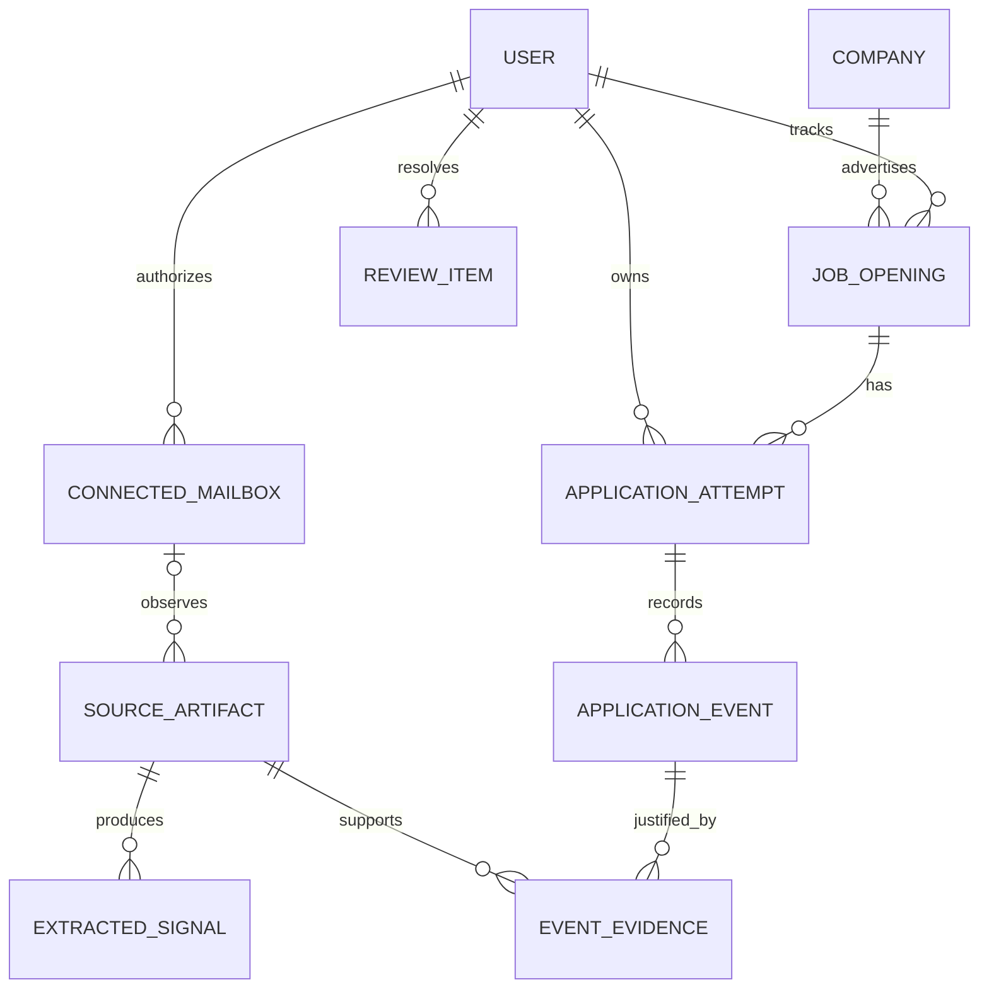

# Data model and identity resolution

**Status:** Proposed. PostgreSQL relational design; not a migration.

## 1. Four separate notions of identity

1. **Tracker user:** Owner who logs into Ledger.
2. **Connected mailbox:** One Google account authorized for reading and synchronization. Identified by stable Google account subject, not mutable display email.
3. **Submitted contact snapshot:** Email address and/or phone number entered for an individual application. A forwarding recipient or sync mailbox may be different. Unknown values remain NULL.
4. **Employer ATS candidate identity:** May link multiple submissions by name, phone, email, LinkedIn, or proprietary rules. We generally **cannot verify or assert** its identity.

Neither (mailbox ID, job opening) nor (email, phone, opening) is a unique application key. Repeated submissions are separate only when supported by distinct submission evidence; duplicate confirmations of one submission are not new attempts.

## 2. Entity relationship diagram



### Canonical entities

| Entity | Key fields / notes |
| --- | --- |
| users | id, created_at |
| connected_mailboxes | id, user_id, provider, provider_subject, address, encrypted_refresh_token, key_version, sync_state, history_id **as string**, last_success_at, last_error_code, revoked_at |
| companies | id, canonical_name, normalized_domain (optional) |
| job_openings | id, user_id, company_id, title, location, ats_provider, ats_tenant, requisition_id, canonical_url, listing_state, listing_checked_at |
| application_attempts | id, user_id, job_opening_id, applicant_email_snapshot, phone_ciphertext, phone_match_digest (optional), submitted_at, submission_confidence, external_application_id, projected_stage, projected_outcome, created_at |
| source_artifacts | id, user_id, source_kind (GMAIL, FORWARDED_EML, MANUAL), mailbox_id nullable, provider_message_id nullable, original_rfc_message_id nullable, parent_artifact_id nullable, source_fingerprint, timestamp fields, body_access_audit metadata |
| extracted_signals | id, source_artifact_id, extractor_version, event_kind, redacted_fields_json, confidence, processing_state |
| application_events | id, user_id, attempt_id, event_kind, occurred_at, observed_at, origin (AUTO/MANUAL), review_state (ACCEPTED/REJECTED/SUPERSEDED), dedupe_key |
| event_evidence | event_id, source_artifact_id, evidence_type, redacted_excerpt nullable |
| review_items | id, user_id, reason, signal_id, candidate_attempt_ids, state, reviewer_action |
| sync_runs | id, mailbox_id, kind, started_at, finished_at, scan_window, cursor_before, cursor_after, scanned_count, status, safe_error_code |

Keep secrets and sensitive field encryption in separate restricted access paths. Raw bodies and binary attachments do not belong in these default tables.

## 3. Important constraints

```sql
-- Schematic, not the complete migration.
CREATE UNIQUE INDEX mailbox_provider_identity
  ON connected_mailboxes (user_id, provider, provider_subject);

-- The same Gmail message can appear in a re-run, but not as a new source.
CREATE UNIQUE INDEX gmail_source_once_per_mailbox
  ON source_artifacts (mailbox_id, provider_message_id)
  WHERE source_kind = 'GMAIL';

CREATE UNIQUE INDEX application_event_dedupe
  ON application_events (user_id, dedupe_key);

-- Do NOT create a unique constraint on (job_opening_id, applicant_email_snapshot).
-- Do NOT create a unique constraint on (job_opening_id, phone_match_digest).
```

Additional requirements:
- Enforce that a linked attempt, opening, artifact, event and review item share the **same user_id** (composite scoped FKs or equivalent transactional checks; add row-level security in a multi-tenant production deployment).
- Use **unique authoritative ATS keys** only with their full provider/tenant/requisition scope; do not assume bare numeric requisition IDs are globally unique.
- Gmail IDs are only unique **within a mailbox**; thread IDs are not application IDs.
- RFC Message-ID is useful for duplicate-evidence detection **but not a primary or globally unique key**. It can be missing/reused/changed by forwarding.
- Phone numbers can be normalized to E.164 when country context is known, encrypted for display, and optionally indexed by a keyed HMAC digest for same-user comparison; never expose digests as stable public identifiers.
- Subject, header contents and URLs may contain sensitive tokens; persist only redacted fields required by the product.

## 4. Event sourcing, but narrowly scoped

Use append-only accepted **application domain events** plus a transactional materialized attempt projection.

Example:
- Oct 1: attempt A SUBMITTED (Gmail A)
- Oct 8: attempt A REJECTED (Gmail A)
- Oct 11: attempt B SUBMITTED (Gmail B, same opening)
- Oct 13: attempt B INTERVIEW_INVITED

Projected opening aggregate may say **one active interview attempt**; it must not overwrite attempt A. **Accepted** versus **proposed** events must be distinguished. Late-arriving email can represent earlier event time; keep both **occurred_at** and **observed_at**.

Proposed event types: SUBMITTED, CONFIRMATION_RECEIVED, ASSESSMENT_INVITED, INTERVIEW_INVITED, INTERVIEW_SCHEDULED, REJECTION_RECEIVED, OFFER_RECEIVED, WITHDRAWN, MANUAL_CORRECTION. Avoid deriving terminal outcomes from subject line alone.

Projection logic is deterministic and versioned. Manual corrections can reject/supersede earlier inferred signals without destroying provenance. Explicitly model a review item for conflicts rather than using "latest email wins".

## 5. Matching policy

**Job-opening resolution** (in descending evidentiary strength):
1. Same ATS tenant + requisition ID / canonical ATS application URL.
2. Same validated canonical job URL.
3. Company + title + location + time interval as possible match only; title alone is weak.
4. Company alone is insufficient.

**Attempt resolution**:
1. Provider application ID when it is actually attached to an observed submission.
2. Applicant contact snapshot and original recipient, combined with submission time, thread linkage, explicit reference and role.
3. Same mailbox is a hint only; a forwarded email or alias may belong to another identity.
4. A confirmed second submission creates another attempt; the same confirmation resent or forwarded does not.
5. Multiple plausible attempts → review queue. Do not assign terminal outcomes by guesswork.

A fresh email address or phone number **does not prove a fresh ATS profile**; record employer-side dedup as UNKNOWN unless supported by an observed ATS result.

## 6. Listing availability and timelines

Maintain independent timestamps:
- **submitted_at:** when the submission happened, if known.
- **occurred_at:** when a recruitment event happened.
- **observed_at:** when Ledger discovered it.
- **last_successful_mailbox_sync_at:** state of continuous monitoring.
- **listing_checked_at:** timestamp of a verified posting check.

Backfill defaults to **60 rolling days**; records are not expired at 60 days. An old attempt stays visible if active or actionable. "No response" must be rendered as **no response observed within connected sources**, and coverage must be shown beside it.

## 7. Open schema questions

- Whether a reusable, user-controlled **contact profile** should coexist with immutable snapshots on every attempt.
- Policy for preserving derived application history when one mailbox is disconnected vs the user requests deletion.
- Which evidence excerpts are necessary for explanation versus safe to omit completely.
- Indexing and partitioning only if actual message volumes justify them.
