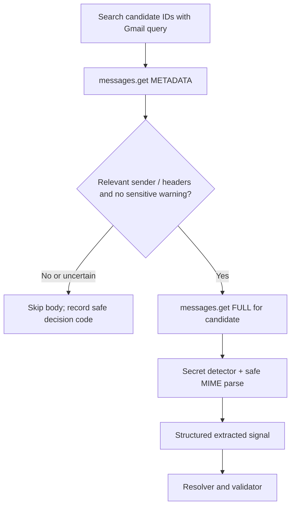

# Ingestion, historical import, and Gmail synchronization

**Status:** Proposed. Two V1 source adapters share the same extraction pipeline.

## 1. Source modes

| Mode | Permission/ingress | History | Ongoing coverage |
| --- | --- | --- | --- |
| Dedicated Gmail, connected | Per-account read-only OAuth | Default 60-day backfill | Scheduled incremental sync |
| Primary Gmail, selectively forwarded | No OAuth connection | User selects and forwards .eml messages | Only explicitly forwarded updates |
| Future browser extension | Separate user permission, not V1 | Captures confirmed submission | Only for supported sites |

Do not ask the user to grant primary-inbox OAuth merely for old data. The source and applicant identity must remain separate: a message received in the tracking mailbox could describe a submission originally made with another address.

## 2. Connection flow

1. User explicitly connects **one** dedicated Gmail account using OAuth with offline access and PKCE where appropriate.
2. Validate mailbox profile and bind the stable Google subject to the user's Ledger account.
3. Encrypt refresh token before persistence; constrain decrypt/use to Gmail worker.
4. Set the connection to CONNECTED_INITIALIZING. Persist the baseline mailbox history ID **before** historical scanning.
5. Queue a bounded 60-day backfill and then a catch-up history scan from the baseline ID.
6. Mark backfill complete only when every page and durable processing step in the requested window has been accounted for; record counts and gaps.

Google's **gmail.readonly** scope is restricted and can technically read the entire authorized mailbox; filtering the application to job messages does not scope the OAuth grant. The narrower **gmail.metadata** scope cannot be used with the Gmail **messages.list q search** parameter and cannot retrieve bodies. Use read-only, never modify/send permissions for V1.

## 3. Candidate discovery and staged retrieval

Gmail **messages.list** returns IDs and thread IDs, not message bodies. **messages.get** supports METADATA (headers) and FULL (body payload). Build *conservative* candidate queries using known ATS sender domains and recruitment patterns; use multiple paginated queries with overlapping coverage. No single keyword search is comprehensive, and headers alone cannot catch every secret. A privacy gate should fail closed on obvious OTP/reset/login correspondence, but must **not claim zero sensitive-body reads**.

### Recall safeguards

Missing a real recruiting email is the costliest failure, so each stage errs toward review rather than silent loss:

- **Discovery** runs overlapping queries: known hiring-platform senders (`src/ingestion/ats.ts`), inflected subject words (Gmail matches whole words, so `interviews`/`applications` are listed explicitly), job-board confirmation senders, body recruitment phrases, and spam from hiring platforms.
- **Spam** is accepted only when DMARC-authenticated as a known hiring-platform domain; anything else in spam is finished as `SKIPPED_SPAM`.
- **Header gate** treats a hiring-platform sender with a non-account subject as a candidate. When headers alone are inconclusive, the worker asks Gmail's own search whether that one message (`rfc822msgid:`) contains a recruitment phrase. Only matching ids come back; no body is read unless that check passes.
- **Extraction** normalizes typographic quotes, Unicode spaces and hard line wraps before matching, uses the HTML alternative when the text part is a stub, and fills missing fields from it.
- **Synced messages** are dismissed only when nothing suggests hiring mail. Mixed signals, and unrecognised mail from a hiring platform, become review items. A rejection that also mentions an interview is proposed with low confidence and always needs a human.

Record aggregate counts for ID discovery, header inspection, body fetch, accepted events, exclusions, and ambiguous reviews, **without keeping message bodies, raw headers or secrets in logs**.

Connections exposes processing totals and a bounded exclusion list with owner-only
links to Gmail. Parser upgrades can recover skipped recent mail through
**Recheck last 60 days**; see [import-recovery.md](import-recovery.md). Existing
timelines and review decisions are protected. Missing dates are not inferred from
Received hops, complete recipient identity is retained within a fixed cap, and
damaged attachment siblings produce explicit partial-processing results.

## 4. Rolling 60-day backfill

- On first connection, default **lookback_days=60** using the connection time as the anchor, with explicit user-controlled extension later.
- Store **backfill_window_start/end**, pages completed and scan status. Use calendar date filters carefully: Gmail search date parsing uses PST midnight by default; use epoch seconds or margin + application-side timestamp validation when exact boundaries matter.
- Scan all relevant inbound messages and selected sent correspondence if needed, with configurable queries. Do not assume a job-confirmation email exists for every application.
- If the scan misses older applications, allow **targeted historical lookup** for a company/requisition or a longer user-authorized backfill.
- A message received today about a submission made a year ago must still be considered for matching; do not apply a 60-day attempt-age cap to incremental updates.

The dashboard default time filter can show recent 60 days **plus** older pending/actionable applications. The database must not automatically delete attempts at 60 days.

## 5. Incremental sync and cursor durability

V1: schedule **per-mailbox polling roughly every 10–15 minutes** (configuration, not a guaranteed latency SLA).

Algorithm:
1. Lease mailbox sync with a short expiry.
2. Retrieve Gmail history changes using stored **startHistoryId** and paginate.
3. Persist changed message identifiers and durable processing jobs with unique keys; transactionally advance the cursor only after *all* relevant pages have been durably accounted for.
4. Fetch candidate metadata and eligible bodies in retryable downstream jobs.
5. Track sync latency and show failures/coverage gaps in UI.
6. On Gmail history HTTP 404 (expired/invalid cursor), set **RESYNC_REQUIRED**, run a fresh bounded full resync, and restore a valid checkpoint; never silently skip the gap.

History IDs should be stored as **opaque strings** (do not assume sequential contiguous integers). Retries must be idempotent. For later scale, Gmail push notifications send mailbox/history-change hints through Pub/Sub; watches must be renewed at least every 7 days, Google recommends daily. Pub/Sub is **not part of V1**.

## 6. Selective .eml forwarding

Workflow: user searches/selects relevant messages in a primary account and chooses **Forward as attachment** to a connected dedicated account. That produces an attached original message rather than an ordinary quoted-forward snippet.

- The outer forwarded email is a **transport envelope**. The embedded original message is the **evidence**.
- Parse only well-formed **message/rfc822 / .eml** from approved forwarded-message processing; no arbitrary attachment scraping or execution.
- Enforce maximum size, nesting depth, MIME part count, header size, encoding limits and recursion limits. Reject malformed attachments safely.
- Track original From/To/Date/Message-ID separately from envelope sender/recipient/date. Treat all these as untrusted until validated; **never** set submitted_at = forwarding date.
- Deduplicate copies of the same original evidence without merging distinct application attempts. Do not use RFC Message-ID alone as a globally unique identifier.
- When a new recruiter reply is selectively forwarded, resolve it to an existing historical attempt by application evidence; otherwise request review.
- The privacy gate must also screen attached originals for OTPs/reset/magic links; explicit forwarding is not blanket permission to store all their contents.

Ordinary inline forwards may be partially supported later but are weaker because headers and timestamps can be rewritten, missing or ambiguous.

## 7. Reconciliation and provenance

Every source item becomes a normalized **source artifact** with:
- source kind, user, mailbox (if applicable), source message ID or attachment fingerprint;
- original and transport timestamps/identities when available;
- safe extraction/parser version;
- transient body-access reason and audit decision;
- candidate event signal with confidence and supporting evidence reference.

Classify → extract → identify opening → identify attempt → validate → accept or review. Extraction logic must never call a "set status" endpoint directly.

## 8. Failure and safety cases

| Case | Expected behavior |
| --- | --- |
| Replayed Gmail event | Upsert source, no duplicate lifecycle event |
| Token revoked | Pause that mailbox; mark coverage degraded; other mailboxes continue |
| Old history cursor | Resync and display coverage gap until resolved |
| Gmail rate limiting | Backoff and retry with limits; no cursor loss |
| Same email forwarded and synced | One underlying signal, multiple evidence observations when useful |
| ATS sends login OTP | Do not classify as application; do not intentionally retrieve body |
| Two same-title openings | Remain separate until strong opening match |
| Rejection cannot identify attempt | Review item; no automatic terminal change |
| Backfill partially complete | Explicit coverage indicator; do not claim exhaustive history |

## References

- [Gmail messages.list](https://developers.google.com/workspace/gmail/api/reference/rest/v1/users.messages/list)
- [Gmail messages.get](https://developers.google.com/workspace/gmail/api/reference/rest/v1/users.messages/get)
- [Gmail sync guide](https://developers.google.com/workspace/gmail/api/guides/sync)
- [Gmail push guide](https://developers.google.com/workspace/gmail/api/guides/push)
- [Gmail filtering guide](https://developers.google.com/workspace/gmail/api/guides/filtering)
- [Forward as attachment (Gmail help)](https://support.google.com/mail/answer/9259768)
