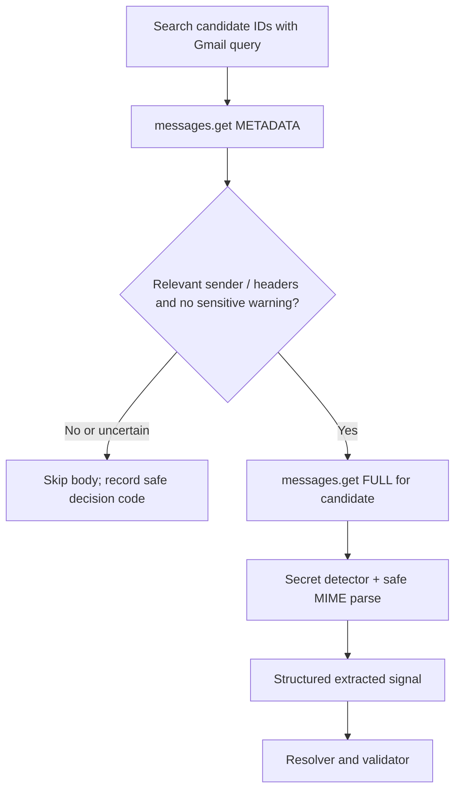

# Ingestion, historical import, and Gmail synchronization

**Status:** Implemented browser prototype. Gmail and selected `.eml` sources share the rules-9 extraction pipeline. Deployment hardening and live-provider validation remain separate work.

## 1. Source modes

| Mode | Permission/ingress | History | Ongoing coverage |
| --- | --- | --- | --- |
| Dedicated Gmail, connected | Per-account read-only OAuth | Default 60-day backfill | Scheduled incremental sync |
| Primary Gmail, selectively forwarded | No OAuth connection | User selects and forwards .eml messages | Only explicitly forwarded updates |
| Future browser extension | Separate user permission, not V1 | Captures confirmed submission | Only for supported sites |

Do not ask the user to grant primary-inbox OAuth merely for old data. The source and applicant identity must remain separate: a message received in the tracking mailbox could describe a submission originally made with another address.

## 2. Connection flow

1. User explicitly connects **one** dedicated Gmail account using OAuth with offline access and PKCE where appropriate.
2. Validate mailbox profile and bind the stable Google subject to the user's Ledger account.
3. Encrypt refresh tokens before persistence. The connector uses the token vault; it currently shares the API runtime and is not a separate credential boundary.
4. Set the connection to CONNECTED_INITIALIZING. Persist the baseline mailbox history ID **before** historical scanning.
5. Queue a bounded 60-day backfill and then a catch-up history scan from the baseline ID.
6. Mark backfill complete only when every page and durable processing step in the requested window has been accounted for; record counts and gaps.

Google's **gmail.readonly** scope is restricted and can technically read the entire authorized mailbox; filtering the application to job messages does not scope the OAuth grant. The narrower **gmail.metadata** scope cannot be used with the Gmail **messages.list q search** parameter and cannot retrieve bodies. Use read-only, never modify/send permissions for V1.

## 3. Candidate discovery and staged retrieval

Gmail **messages.list** returns IDs and thread IDs, not message bodies. **messages.get** supports METADATA (headers) and FULL (body payload). Build *conservative* candidate queries using known ATS sender domains and recruitment patterns; use multiple paginated queries with overlapping coverage. No single keyword search is comprehensive, and headers alone cannot catch every secret. A privacy gate should fail closed on obvious OTP/reset/login correspondence, but must **not claim zero sensitive-body reads**.

### Recall safeguards

Missing a real recruiting email is the costliest failure, so each stage errs toward review rather than silent loss:

- **Discovery** runs overlapping queries: known hiring-platform senders (`src/ingestion/ats.ts`), inflected subject words (Gmail matches whole words, so `interviews`/`applications` are listed explicitly), job-board confirmation senders, body recruitment phrases, and spam from hiring platforms.
- **Spam** is accepted only when DMARC-authenticated as a known hiring-platform domain; anything else in spam is finished as `SKIPPED_SPAM`.
- **Header gate** treats a hiring-platform sender with a non-account subject as a candidate. When headers alone are inconclusive, the worker asks Gmail's own search whether that one message (`rfc822msgid:`) contains a recruitment phrase. Only matching ids come back; no body is read unless that check passes.
- **Extraction** normalizes typographic quotes, Unicode spaces and hard line wraps before matching. All distinct MIME alternatives contribute consistent field decisions; ambiguity in either representation remains ambiguity. Repeated alternatives do not add votes, and calendar parts are parsed once per original message.
- **Synced messages** are dismissed only when nothing suggests hiring mail. Mixed signals, and unrecognised mail from a hiring platform, become review items. A rejection that also mentions an interview is proposed with low confidence and always needs a human.

Record aggregate counts for ID discovery, header inspection, body fetch, accepted events, exclusions, and ambiguous reviews, **without keeping message bodies, raw headers or secrets in logs**.

Connections exposes processing totals and a bounded exclusion list with owner-only
links to Gmail. Parser upgrades can recover skipped recent mail through
**Recheck last 60 days**; see [import-recovery.md](import-recovery.md). Existing
timelines and review decisions are protected. Missing dates are not inferred from
Received hops, complete recipient identity is retained within a fixed cap, and
damaged attachment siblings produce explicit partial-processing results.

## 4. Rolling 60-day backfill

- On first connection, default **lookback_days=60** using the connection time as the anchor, with explicit user-controlled extension later.
- Store **backfill_window_start/end**, pages completed and scan status. Use calendar date filters carefully: Gmail search date parsing uses PST midnight by default; use epoch seconds or margin + application-side timestamp validation when exact boundaries matter.
- Scan all relevant inbound messages and selected sent correspondence if needed, with configurable queries. Do not assume a job-confirmation email exists for every application.
- If the scan misses older applications, allow **targeted historical lookup** for a company/requisition or a longer user-authorized backfill.
- A message received today about a submission made a year ago must still be considered for matching; do not apply a 60-day attempt-age cap to incremental updates.

The dashboard default time filter can show recent 60 days **plus** older pending/actionable applications. The database must not automatically delete attempts at 60 days.

## 5. Incremental sync and cursor durability

V1: schedule **per-mailbox polling roughly every 10–15 minutes** (configuration, not a guaranteed latency SLA).

Algorithm:
1. Lease mailbox sync with a short expiry.
2. Retrieve Gmail history changes using stored **startHistoryId** and paginate.
3. Persist changed message identifiers and durable processing jobs with unique keys; transactionally advance the cursor only after *all* relevant pages have been durably accounted for.
4. Fetch candidate metadata and eligible bodies in retryable downstream jobs.
5. Track sync latency and show failures/coverage gaps in UI.
6. On Gmail history HTTP 404 (expired/invalid cursor), set **RESYNC_REQUIRED**, run a fresh bounded full resync, and restore a valid checkpoint; never silently skip the gap.

History IDs should be stored as **opaque strings** (do not assume sequential contiguous integers). Retries must be idempotent. For later scale, Gmail push notifications send mailbox/history-change hints through Pub/Sub; watches must be renewed at least every 7 days, Google recommends daily. Pub/Sub is **not part of V1**.

## 6. Selective .eml forwarding

Workflow: user searches/selects relevant messages in a primary account and chooses **Forward as attachment** to a connected dedicated account. That produces an attached original message rather than an ordinary quoted-forward snippet.

- The outer forwarded email is a **transport envelope**. The embedded original message is the **evidence**.
- Parse only well-formed **message/rfc822 / .eml** from approved forwarded-message processing; no arbitrary attachment scraping or execution.
- Enforce maximum size, nesting depth, MIME part count, header size, encoding limits and recursion limits. Reject malformed attachments safely.
- Track original From/To/Date/Message-ID separately from envelope sender/recipient/date. Treat all these as untrusted until validated; **never** set submitted_at = forwarding date.
- Deduplicate copies of the same original evidence without merging distinct application attempts. Do not use RFC Message-ID alone as a globally unique identifier.
- When a new recruiter reply is selectively forwarded, resolve it to an existing historical attempt by application evidence; otherwise request review.
- The privacy gate must also screen attached originals for OTPs/reset/magic links; explicit forwarding is not blanket permission to store all their contents.
- The body screen (`src/ingestion/privacy.ts`) has three levels. **CREDENTIAL** (codes, password
  resets, account verification, magic links, bearer tokens, raw secret parameters): nothing derived
  from the message is kept. **ACCESS_LINK** (an opaque token on a portal, assessment, scheduling or
  login link): kept only when the transient extraction finds hiring content, because nearly every
  ATS email carries such links; otherwise skipped like a credential. **NONE** (click tracking,
  unsubscribe, signed static assets). Links themselves are never stored at any level: fields pass
  `safeField`, and canonical URLs come only from reviewed ATS schemas without query strings.

Ordinary inline forwards may be partially supported later but are weaker because headers and timestamps can be rewritten, missing or ambiguous.

## 6a. How fields are extracted, and how the extractor is measured

**Type** (confirmation, assessment, interview, rejection, offer) comes from phrase rules in
`src/ingestion/extract.ts`. A confirmation needs a phrase that says an application was received or
submitted; courtesy lines such as "thank you for your interest" also open talent-community and
newsletter mail, so they never count alone. Unsubmitted drafts ("complete your application") and
talent-community sign-ups are not confirmations.

**Company and title** come from candidates in `src/ingestion/fields.ts`. Each candidate records
the sources that support it, named explicitly at every call (`subject`, `body:label`,
`body:sentence`, `body:calendar`, `body:layout`, `body:signature`, `sender:display`, `domain`).
Support is the sum over distinct sources of each source's strongest mention. The subject is one
statement, so all rules reading it share one source. In the body, different mechanisms corroborate
(a "Job Title:" line and a sentence naming the same role), while repeated mentions and the
wrapped/flattened copies of one sentence count once, so repetition cannot outweigh an explicit field.
Employer spellings that differ only in case, punctuation or legal form ("Acme", "ACME",
"Acme, Inc.") share one candidate via `companyKey()`; a shared prefix ("Acme" / "Acme Robotics")
never merges. Credible conflicting names or roles produce an
`AMBIGUOUS` decision and a `CONFLICTING_FIELDS` review item before any opening or attempt is created.
This conflict veto is deliberate: support weights are not calibrated probabilities, and a high
score does not authorize ignoring another explicit employer/role assertion. Fix false captures or
their region/role binding rather than introducing an arbitrary score-ratio override.
The persisted diagnostics contain bounded sanitized candidates and source categories, never source
sentences. Scores are heuristic support weights, not calibrated probabilities. Candidate and span
limits prevent adversarial input from growing diagnostics or comparison work without bound.

`src/ingestion/regions.ts` separates current content, signatures, and quoted history. Quoted text
cannot supply current event assertions, job links, application IDs, or submitted contact details.
HTML blockquotes and recognized quoted containers preserve those boundaries. Short inline quotes
do not suppress following authored text; wrapped reply headers and recognized HTML metadata tables
are handled structurally. A standalone early "Thanks" does not hide later application facts.
Signatures provide weak employer evidence. LinkedIn
and Indeed layout extraction requires a board sender, a receipt anchor, and the expected layout;
ordinary footer adjacency is not a title source.

Employer domain corroboration uses `tldts` and the Public Suffix List, including private tenant
boundaries. A full normalized name must match the registrable label, or an explicitly supplied
alias. Prefix matches never establish an employer, and domains never invent missing company names.
See [Public Suffix List](https://publicsuffix.org/learn/) and
[tldts](https://github.com/remusao/tldts).

**Calendars.** Bounded `text/calendar` MIME parts pass the same privacy screen as all other
representations. `ical.js` reads one nonrecurring interview event per part without loading external
resources or expanding recurrences. Supported REQUESTs retain a hashed UID, revision sequence,
organizer domain, and an absolute `scheduledFor` time separately from the email's `occurredAt`.
Floating or unknown-zone times, recurring events, malformed data, conflicting parts, and tentative
requests require review. CANCEL messages remain review items and never create a scheduled event.
Accepted UIDs can identify later revisions only with a verified source and a compatible known
organizer, sender, opening and applicant identity. Duplicate revisions link evidence to the accepted event,
and stale or conflicting revisions cannot overwrite it. UID matching remains owner-scoped and
cannot override an explicit conflicting application ID. The formats are specified by
[RFC 5545](https://www.rfc-editor.org/rfc/rfc5545) and
[RFC 6047](https://www.rfc-editor.org/rfc/rfc6047).

Events store typed calendar facts and evidence links point to the exact accepted signal version.
Historical, dismissed parser proposals cannot participate in calendar identity matching. Accepted
revision history remains visible; the latest accepted revision supplies the current interview time
and the dashboard agenda. Legacy provenance is backfilled only when unambiguous. Cancelling or
rejecting an interpretation requires review/owner action; revisions do not erase accepted history.

**Measurement.** `tests/corpus/emails.ts` is the synthetic development/regression corpus.
`tests/corpus/holdout.ts` retains fixed evaluation cases. Disclosed failures used to guide fixes are
promoted to development; replacement cases written by the same developer are not independent
proof of generalization. These small synthetic sets do not establish real-mail accuracy. For that,
use independently labelled, sanitized data grouped by employer/template family and a fixed test
set that does not guide development.

Run `npm run eval:parser` or `npm run eval:parser -- holdout` for accuracy, emitted-value precision,
positive-field recall, coverage, support counts, and individual misses. Correct empty values count
only toward accuracy, never toward positive recall or precision. Undefined precision/recall is
reported as `n/a`. `tests/corpus-ingestion.test.ts` also runs every positive development email
through a strict model of generated Gmail discovery queries, header/privacy gates, extraction, and
final database processing. This model is not a live Gmail integration test. Mutation tests check
wrapping, quoted history, footers, and repeated evidence; pipeline tests assert that ambiguous
values never create false applications.

**Rule attribution.** Every company/title rule has a stable id (`FIELD_RULES` in
`src/ingestion/fields.ts`), and each field decision records which rules proposed each candidate.
`eval:parser` reports, per rule, how many email fields it fired on, how often it backed a correct
or a wrong value, and how often it proposed the labelled value but lost. Rules that back wrong
values are the first to tighten; rules that never fire have no example. `tests/rule-coverage.test.ts`
requires every rule to fire on a labelled email or on a named example, so a rule cannot be added
without one.

**Upgrade preview.** `npm run preview:parser -- original.eml --baseline-ref COMMIT` compares the
current extractor with a locally available Git revision using the current MIME decoding and installed
dependencies. It creates a temporary checkout for code comparison, screens every representation,
and prints only safe structured proposals and field changes. It does not read Gmail, access a
production database, or update events. Sensitive inputs report only `SKIPPED_SENSITIVE`. The
ordinary recheck still protects all accepted events and review decisions. Inspect preview changes
and use the existing owner review/correction actions for historical mistakes; a version bump is not
permission to rewrite accepted history.

## 7. Reconciliation and provenance

Every source item becomes a normalized **source artifact** with:
- source kind, user, mailbox (if applicable), source message ID or attachment fingerprint;
- original and transport timestamps/identities when available;
- safe extraction/parser version;
- transient body-access reason and audit decision;
- candidate event signal with confidence and supporting evidence reference.

Classify → extract → identify opening → identify attempt → validate → accept or review. Extraction logic must never call a "set status" endpoint directly.

**Identifying the attempt.** Real ATS mail rarely repeats an application ID or the submitted email,
so an update that states neither matches the opening's only attempt (`SOLE_ATTEMPT` in
`src/domain/resolution.ts`). An identity the attempt contradicts (a different ID, email or phone)
never falls back to it, and an opening with several attempts still needs an identifier or review.
Assessment and interview updates apply on that match. A rejection or offer additionally needs an
authenticated hiring-platform or verified matching employer sender, high confidence, and the attempt's confirmation to have
arrived in the same Gmail mailbox; otherwise it goes to review as `TERMINAL_NEEDS_REVIEW`.

Verified replies can inherit a unique accepted conversation in the same owner/mailbox/sender
scope through hashed Message-ID references or Gmail thread IDs. A verified employer can identify
its unique pending opening without a repeated title. These are resolver decisions: they do not
invent extracted company/title or submitted contact fields. Contradictions, shared/unknown sender
domains, multiple compatible attempts, and candidate overflow remain in review. Receiving `To`
addresses are not submission snapshots. Gmail authentication parsing excludes comments/quoted
reasons and requires aligned Google results; trust still depends on Gmail's receiving boundary.

Both automatic and owner-reviewed confirmations share submission-evidence bookkeeping. Relevant
waiting updates are reconsidered in batches of 25 per changed opening; a durable cursor lets the
scheduler resume the remainder, including when no Gmail grant is configured. Dismissed reviews
remain dismissed. Review cards show sanitized facts/candidates and source links, never body excerpts.

Sync bookkeeping locks only the mailbox; domain mutations retain the owner lock for deduplication.
Task registration and cursor changes remain atomic and lease-fenced. Workers stop starting tasks
when the run budget expires; the next successful lease closes abandoned RUNNING audit records
while retaining checkpointed counters. Processing still runs in bounded HTTP-triggered invocations;
separate worker deployment, cancellation across every dependency, and runtime credential isolation
are not implemented by these changes.

## 8. Failure and safety cases

| Case | Expected behavior |
| --- | --- |
| Replayed Gmail event | Upsert source, no duplicate lifecycle event |
| Token revoked | Pause that mailbox; mark coverage degraded; other mailboxes continue |
| Old history cursor | Resync and display coverage gap until resolved |
| Gmail rate limiting | Backoff and retry with limits; no cursor loss |
| Same email forwarded and synced | One underlying signal, multiple evidence observations when useful |
| ATS sends login OTP | Do not classify as application; do not intentionally retrieve body |
| Two same-title openings | Remain separate until strong opening match |
| Rejection cannot identify attempt | Review item; no automatic terminal change |
| Backfill partially complete | Explicit coverage indicator; do not claim exhaustive history |

## References

- [Gmail messages.list](https://developers.google.com/workspace/gmail/api/reference/rest/v1/users.messages/list)
- [Gmail messages.get](https://developers.google.com/workspace/gmail/api/reference/rest/v1/users.messages/get)
- [Gmail sync guide](https://developers.google.com/workspace/gmail/api/guides/sync)
- [Gmail push guide](https://developers.google.com/workspace/gmail/api/guides/push)
- [Gmail filtering guide](https://developers.google.com/workspace/gmail/api/guides/filtering)
- [Forward as attachment (Gmail help)](https://support.google.com/mail/answer/9259768)
